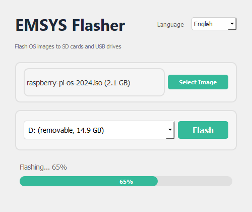
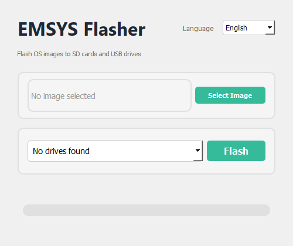
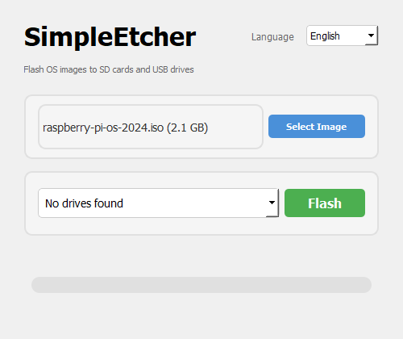
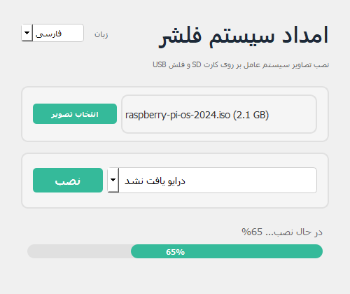

# امداد سیستم فلشر (EMSYS Flasher)

ابزاری سبک و چندسکویی برای نصب تصاویر سیستم عامل بر روی کارت‌های SD و فلش USB. ساخته شده توسط [امداد سیستم](https://emsys.ir).



## ویژگی‌ها
- 🖥️ رابط کاربری مدرن مبتنی بر PyQt5 با برندینگ امدا سیستم
- 🌍 پشتیبانی چندزبانه (انگلیسی و فارسی)
- 🔍 تشخیص خودکار درایوها
- 📊 نوار پیشرفت با نمایش درصد
- 🔄 نصب در پس‌زمینه بدون مسدود کردن رابط کاربری
- 💾 نصب تصاویر سیستم عامل (.iso، .img) بر روی کارت SD و فلش USB
- 🌐 چندسکویی (ویندوز، لینوکس، مک)

## نصب

```bash
pip install PyQt5 pywin32  # در ویندوز: pip install PyQt5 pywin32
```

یا نصب تمام وابستگی‌ها:
```bash
pip install -r requirements.txt
```

## استفاده

اجرای رابط کاربری گرافیکی:
```bash
python etcher.py
```

### مراحل:
1. روی دکمه **انتخاب تصویر** کلیک کنید و فایل .iso یا .img خود را انتخاب نمایید
2. درایو مقصد را از لیست کشویی انتخاب کنید
3. برای شروع عملیات نصب، روی دکمه **نصب** کلیک کنید
4. منتظر بمانید تا نوار پیشرفت کامل شود

## پشتیبانی از زبان‌ها

سیمپل اچر از دو زبان پشتیبانی می‌کند:
- 🇬🇧 انگلیسی (English)
- 🇮🇷 فارسی (Persian) - با چیدمان راست به چپ

برای تغییر زبان، از منوی کشویی در گوشه بالا سمت راست پنجره استفاده کنید.

## اسکرین‌شات‌ها

### حالت اولیه


### انتخاب تصویر، آماده برای نصب


### در حال نصب


### پشتیبانی از زبان فارسی


## پشتیبانی از پلتفرم‌ها
- **ویندوز**: استفاده از pywin32 برای دسترسی مستقیم به درایوها
- **لینوکس**: استفاده از دستور `dd` با گزارش پیشرفت
- **مک**: استفاده از دستور `dd` با گزارش پیشرفت

## نحوه عملکرد

1. تشخیص دستگاه‌های بلوکی/درایوهای موجود در سیستم
2. اعتبارسنجی فایل تصویر و انتخاب درایو مقصد
3. نوشتن تصویر بر روی درایو با استفاده از روش‌های مختص هر پلتفرم در یک رشته پس‌زمینه
4. نمایش پیشرفت عملیات به صورت لحظه‌ای با درصد
5. گزارش موفقیت یا خطا از طریق جعبه‌های پیام

---

© امدا سیستم - مرکز تخصصی ریکاوری اطلاعات و پزشکی دیجیتال | [emsys.ir](https://emsys.ir)